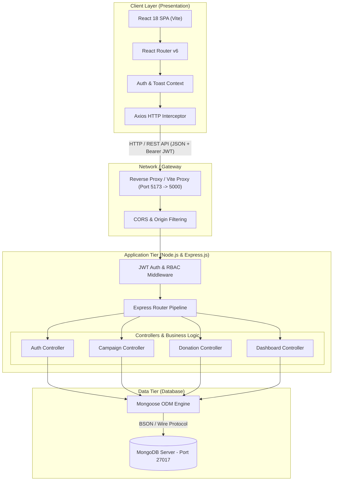
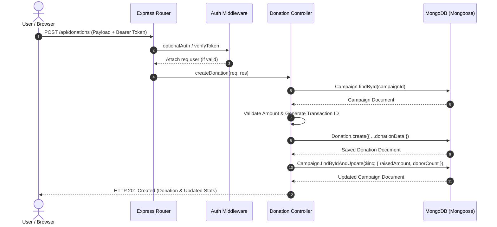
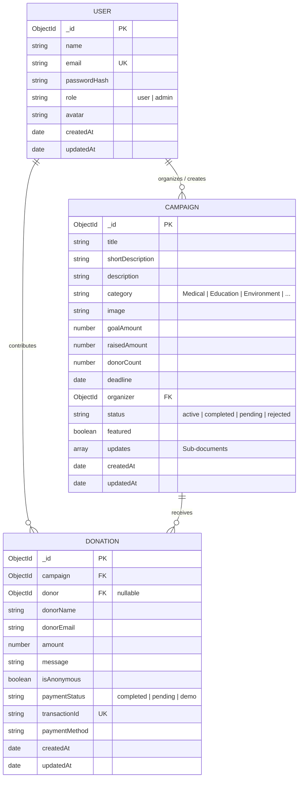
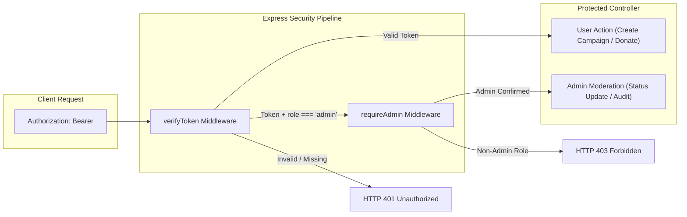
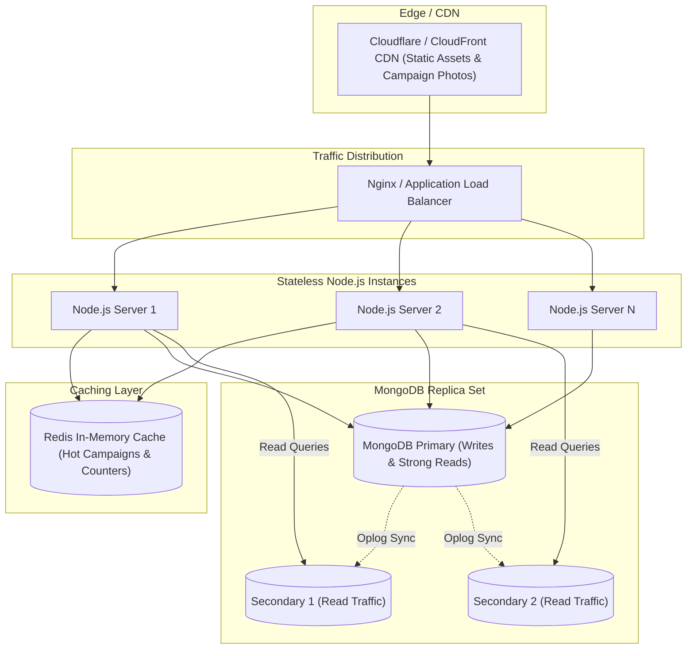

# System Design Document: KindWave Fundraiser Platform (MERN Stack)

---

## 1. Executive Summary & Objective

**KindWave** is a high-trust, responsive, full-stack crowdfunding and charitable donation web application. The platform connects campaign organizers seeking financial assistance for causes (such as Medical, Education, Environment, Animal Welfare, Community, and Emergency relief) with compassionate donors globally.

This document details the complete end-to-end **System Architecture**, encompassing high-level distributed components, database schema and entity-relationship models, low-level component designs, concurrency and atomic transaction patterns, security policies, and performance scalability strategies.

---

## 2. Requirements Engineering

### 2.1 Functional Requirements (FR)
1. **User Management & RBAC**:
   - Registration, login, and secure session management via signed JWTs and salted password hashing (`bcryptjs`).
   - Role-Based Access Control distinguishing standard Users (Organizers & Donors) and Platform Administrators.
2. **Campaign Lifecycle Management**:
   - Campaign creation with target goals, future deadlines, categorized causes, and rich media assets.
   - Live card preview before publication.
   - Campaign editing and deletion restricted strictly to the author or authorized administrators.
   - Milestone updates posted to the campaign timeline.
3. **Donation Processing & Financial Ledger**:
   - Flexible contribution tiers (presets: $10, $25, $50, $100, $250, $500, or custom amounts).
   - Anonymous donor support.
   - Atomic update of campaign financial stats (`raisedAmount`, `donorCount`, `progressPercentage`).
   - Generation of cryptographic demo transaction receipts with unique tracking IDs.
4. **Discovery & Exploration**:
   - Search by keyword/text across titles and descriptions.
   - Multi-facet filtering by category and status (`active`, `completed`).
   - Multi-mode sorting (`newest`, `most-funded`, `deadline`, `goal-high`, `goal-low`).
5. **Dashboards & Administrative Governance**:
   - User Dashboard: Track personal contributions, active campaigns, and access receipts.
   - Admin Console: Platform metrics (total funds, total users, total donations), moderation controls (activate, reject, approve, delete campaigns), and audit logs.

### 2.2 Non-Functional Requirements (NFR)
- **Data Integrity & Consistency**: Financial figures (`raisedAmount`, `donorCount`) must remain strictly consistent, preventing lost updates during concurrent donation spikes.
- **Latency & Performance**: Read endpoints (explore, campaign details) must respond within $<150\text{ ms}$ under standard loads.
- **Availability**: High availability ($99.9\%$), architected for stateless application scaling.
- **Security**: Zero plaintext password storage, protection against unauthorized state modification, strict role verification at the API layer.
- **Auditability**: Every donation must generate an immutable transaction record tied to donor identifiers and campaign references.

---

## 3. High-Level Architecture (HLD)

KindWave is structured following a **3-Tier Modular Client-Server Architecture**:



---

## 4. Low-Level Component Design (LLD)

### 4.1 Client Layer Architecture
- **State Management**:
  - `AuthContext`: Maintains reactive user credentials, authentication status, and role privileges; synchronizes with `localStorage` for session persistence across page refreshes.
  - `ToastContext`: Global message queue rendering animated toast notifications.
- **API Communication & Interceptor Pipeline**:
  - Centralized Axios instance (`api.js`).
  - Request Interceptor: Automatically inspects `localStorage` and injects `Authorization: Bearer <token>` into outgoing requests.
  - Response Interceptor: Catches HTTP 401 Unauthorized responses, clears stale sessions, and routes users to `/login`.
- **Route Guards**:
  - `ProtectedRoute`: Blocks unauthenticated users from creating campaigns or accessing the dashboard.
  - `AdminRoute`: Validates both session presence and `user.role === 'admin'`.

### 4.2 Server Pipeline Architecture


---

## 5. Database Schema & Data Models

The system uses three core Mongoose collections: `users`, `campaigns`, and `donations`.



### 5.1 Data Modeling Strategies & Trade-Offs

#### Normalization vs. Denormalization (Financial Stats)
- **Design Decision**: Instead of running a costly MongoDB aggregation (`$sum: "$amount"`) across thousands of donation documents every time a user views a campaign card or browse page, the `Campaign` schema denormalizes two integer counters:
  - `raisedAmount`: Current accumulated total.
  - `donorCount`: Total successful contributors.
- **Integrity Guarantee**: Handled via MongoDB atomic update operators (`$inc`). Every successful donation transaction updates both the child record and the parent counters simultaneously in the controller.
- **Virtual Property**:
  ```javascript
  campaignSchema.virtual('progressPercentage').get(function () {
    if (!this.goalAmount || this.goalAmount <= 0) return 0;
    return Math.round((this.raisedAmount / this.goalAmount) * 100);
  });
  ```

---

## 6. Concurrency & Transaction Management

### 6.1 The Lost Update Problem
In crowdfunding platforms, popular campaigns often experience rapid concurrent donations. If two users donate \$100 and \$50 simultaneously:

$$\text{Initial: } \$1,000$$

- **Naive Read-Modify-Write**:
  - Request A reads `raisedAmount = 1000`, calculates $1000 + 100 = 1100$.
  - Request B reads `raisedAmount = 1000`, calculates $1000 + 50 = 1050$.
  - Request A writes `1100`.
  - Request B overwrites with `1050` (*\$100 donation lost!*).

- **KindWave Implementation (Atomic Update)**:
  ```javascript
  await Campaign.findByIdAndUpdate(campaign._id, {
    $inc: { raisedAmount: numAmount, donorCount: 1 }
  });
  ```
  MongoDB processes `$inc` operations atomically at the document level via internal lock-free atomics, ensuring that even under heavy concurrent loads:
  $$\text{Final: } \$1,000 + \$100 + \$50 = \$1,150$$

---

## 7. Security & Authorization Architecture



1. **Password Encryption**: `bcryptjs` with auto-generated salt rounds ($10$ rounds) prevents rainbow-table lookups.
2. **Stateless JWT**:
   - Payload: `{ id: user._id, email: user.email, role: user.role }`.
   - Signed with `JWT_SECRET` using HMAC SHA-256 with 7-day expiration.
3. **Defense-in-Depth for Administrative Routes**:
   - Frontend route hiding via `<AdminRoute>` prevents unauthorized UI rendering.
   - Server-side middleware (`requireAdmin`) validates that `req.user.role === 'admin'` before executing controller operations. Modifying client `localStorage` does not grant backend admin access.

---

## 8. Scalability & Performance Strategy

### 8.1 Read/Write Traffic Profiling
- **Read-Heavy Ratio ($\approx 95:5$)**: The vast majority of traffic is users discovering, searching, and reading campaign updates, while writes occur during donations or campaign creation.



### 8.2 Production Optimization Checklist
1. **Database Indexing**:
   - `Campaign`: Compound index `{ category: 1, status: 1, createdAt: -1 }`.
   - `Campaign`: Text index on `{ title: "text", shortDescription: "text", description: "text" }` for search acceleration.
   - `Donation`: Index on `{ campaign: 1, createdAt: -1 }` for instant retrieval of campaign supporter feeds.
   - `User`: Unique index on `{ email: 1 }`.
2. **Horizontal Scaling**: Since Express servers do not hold in-memory session states (all state resides in signed JWTs and MongoDB), instances can scale horizontally behind an Nginx or AWS ALB round-robin balancer.
3. **Database Caching**: Integrating a Redis layer for `GET /api/campaigns` and homepage metrics avoids hitting MongoDB for high-frequency queries.

---

## 9. Failure Modes & Reliability

| Failure Scenario | Impact | Mitigation Strategy |
| :--- | :--- | :--- |
| **MongoDB Outage** | Write failures, 500 API responses | MongoDB Replica Sets with automatic primary failover ($\le 10\text{ s}$). Connection retry logic in `config/db.js`. |
| **Simulated Payment Gateway Latency** | Hanging request, UI freezing | Backend timeout limits with structured client-side loading indicators and feedback messages. |
| **Token Expiration / Tampering** | API rejection | Client-side Axios interceptor intercepts 401, clears invalid tokens from storage, and redirects gracefully to login. |
| **Malicious XSS / Payload Injection** | Script execution | Mongoose typed schema sanitization, automated HTML entity encoding in React Virtual DOM, and strict Express JSON parsers. |

---

## 10. Future Production Roadmap

1. **Live Payment Gateway**: Drop-in integration of Stripe Payment Intents or Razorpay Order APIs with cryptographic Webhook signature verification (`stripe-signature`).
2. **Object Storage**: Migration from image URLs to direct cloud storage (AWS S3 or Cloudinary) via signed multipart form uploads.
3. **Automated Receipts & Emails**: Integration with SendGrid or AWS SES for real-time PDF donation receipt delivery to donor inboxes.
